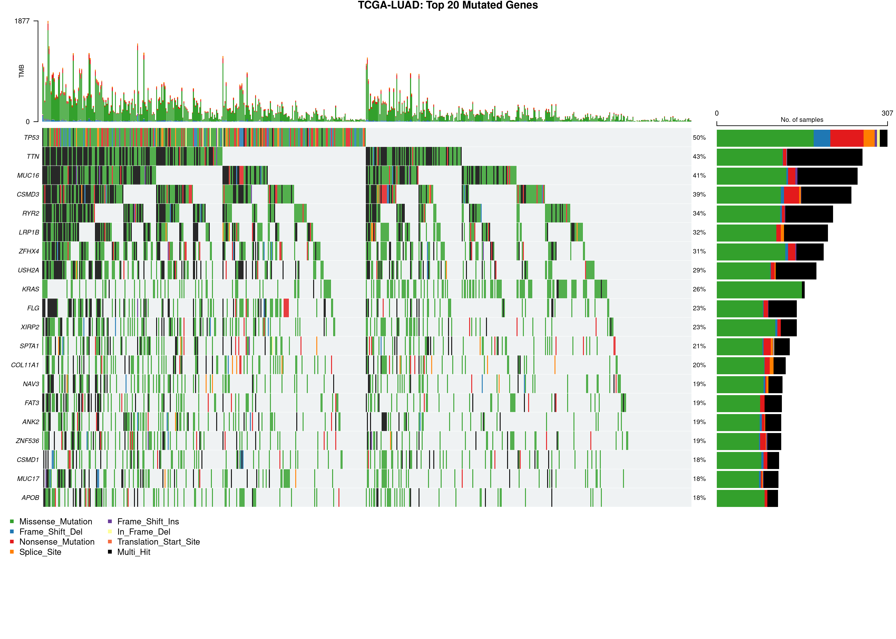
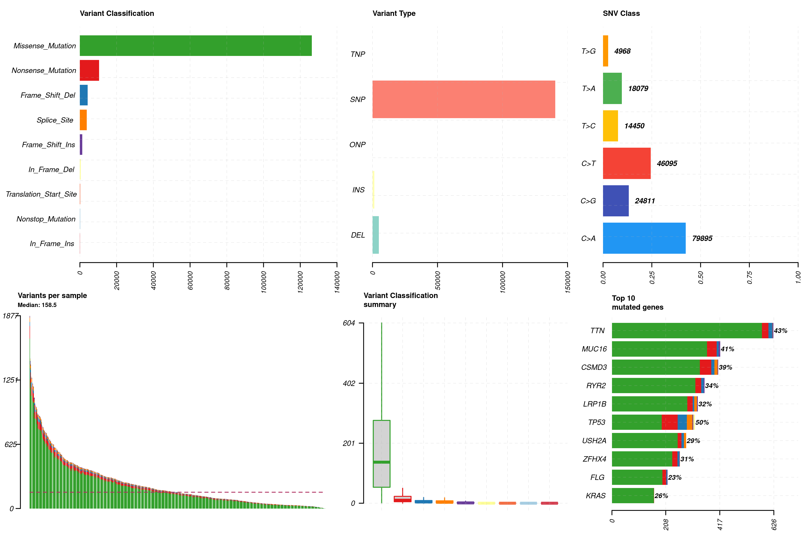
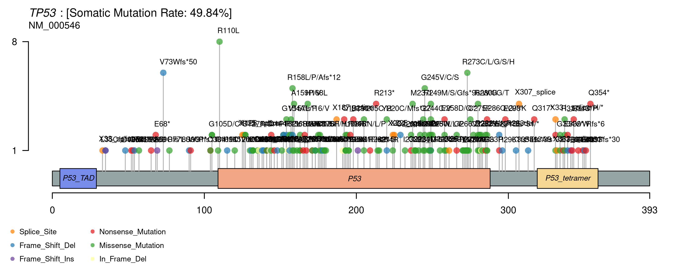
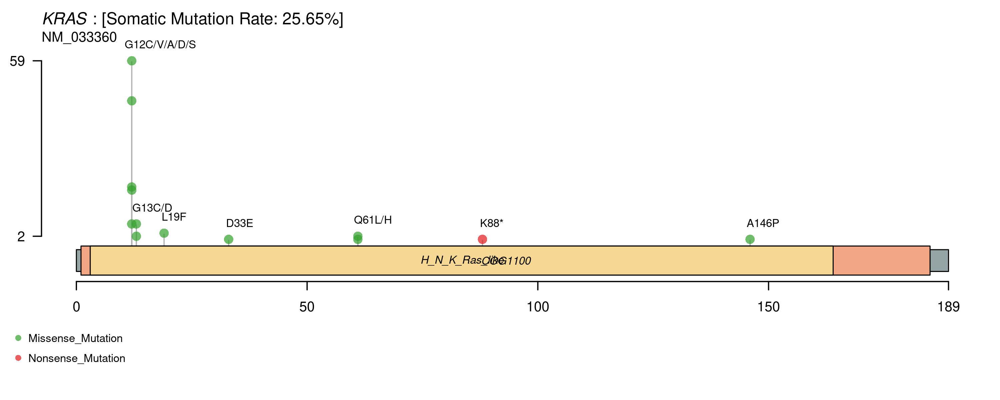
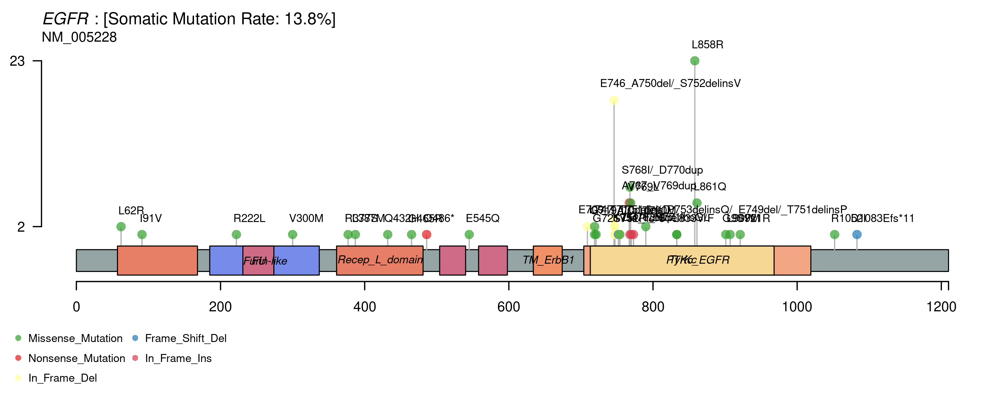
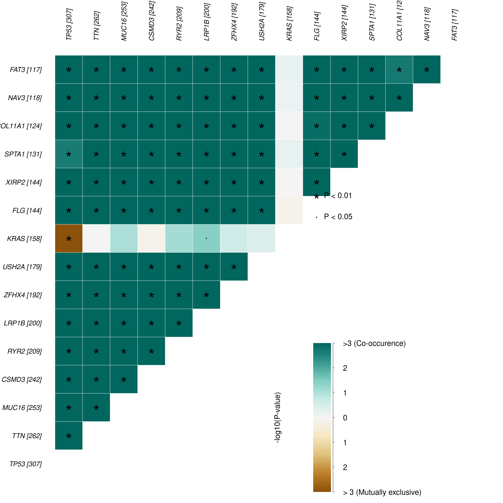
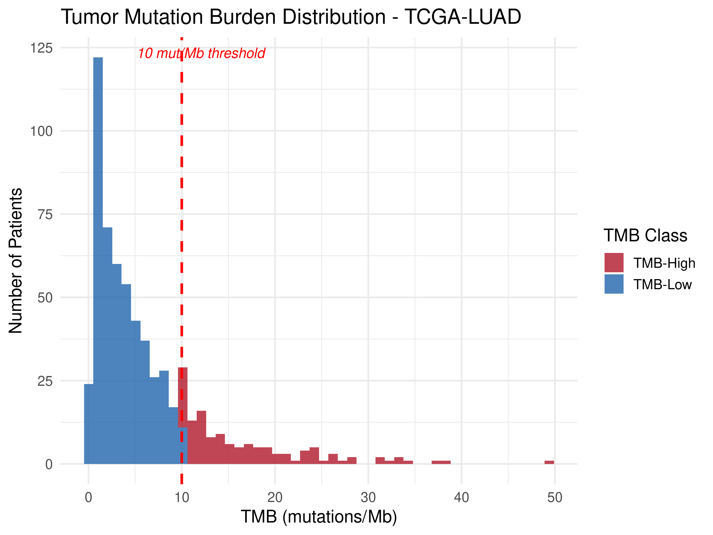
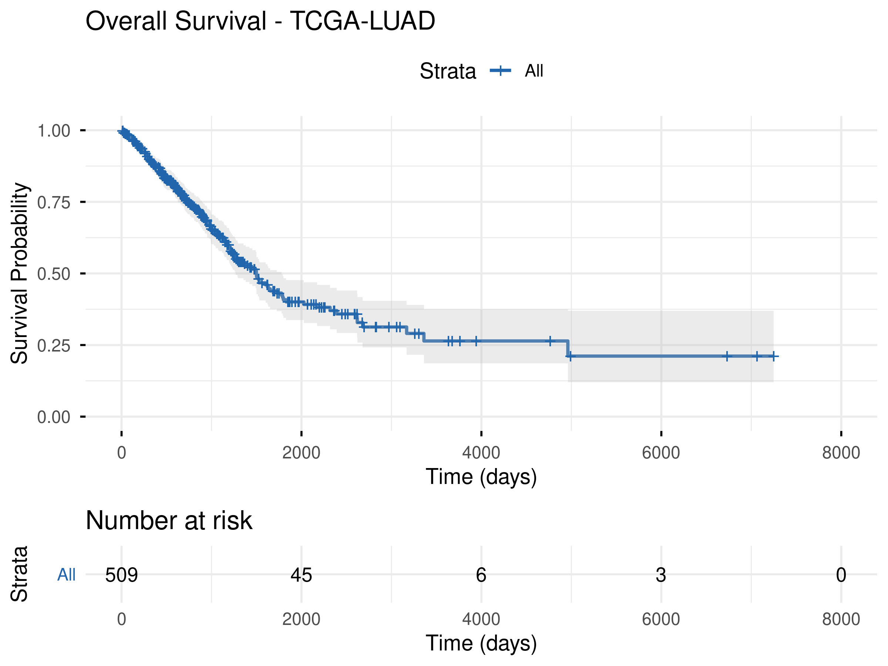
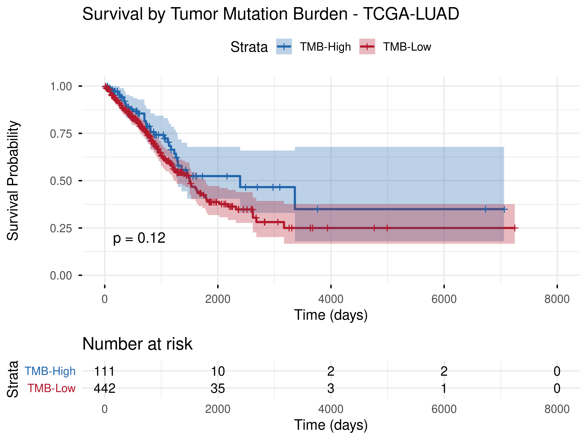
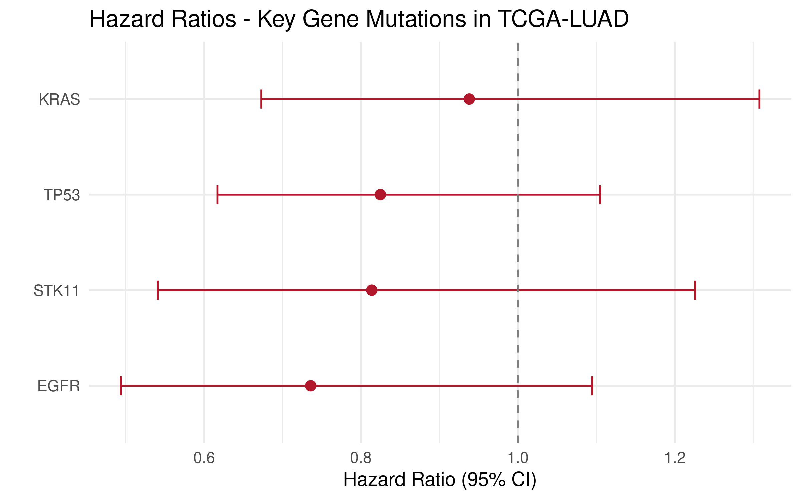

# TCGA-LUAD Somatic Mutation & Survival Analysis

A comprehensive bioinformatics pipeline for somatic mutation profiling of **Lung Adenocarcinoma (LUAD)** using TCGA data. This project uses maftools for mutation landscape visualization, computes Tumor Mutation Burden (TMB), and integrates mutation status with clinical survival outcomes through Kaplan-Meier and Cox regression analysis.

> **Author:** Sohel Ahmed, Ph.D.  
> **Date:** October 2026

---

## Table of Contents

- [Overview](#overview)
- [Dataset](#dataset)
- [Key Results](#key-results)
  - [Mutation Landscape](#mutation-landscape)
  - [Protein-Level Mutations](#protein-level-mutations)
  - [Gene Co-occurrence & Exclusivity](#gene-co-occurrence--exclusivity)
  - [Tumor Mutation Burden](#tumor-mutation-burden)
  - [Survival Analysis](#survival-analysis)
- [Quick Start](#quick-start)
- [Project Structure](#project-structure)
- [Technologies](#technologies)

---

## Overview

Lung adenocarcinoma is the most common subtype of non-small cell lung cancer. Understanding the somatic mutation landscape and its relationship to patient survival is critical for precision oncology. This pipeline demonstrates:

- **Mutation profiling** — Variant calling summary, oncoplot visualization of top mutated genes
- **Protein-level analysis** — Lollipop plots mapping mutation hotspots on TP53, KRAS, EGFR, STK11, KEAP1
- **Gene interactions** — Co-occurrence and mutual exclusivity analysis across driver genes
- **TMB computation** — Tumor Mutation Burden classification (high vs. low) at the 10 mut/Mb threshold
- **Mutation-survival integration** — Kaplan-Meier curves and Cox regression linking driver mutations and TMB to overall survival

---

## Dataset

| Attribute | Value |
|-----------|-------|
| **Source** | [TCGA-LUAD](https://portal.gdc.cancer.gov/projects/TCGA-LUAD) |
| **Data type** | Masked Somatic Mutation (MAF) |
| **Workflow** | Aliquot Ensemble Somatic Variant Merging and Masking |
| **Samples** | 567 tumor samples |
| **Clinical** | Survival, staging, demographics |

---

## Key Results

### Mutation Landscape

**Oncoplot** — Top 20 most frequently mutated genes across all LUAD samples. TP53, TTN, MUC16, KRAS, and RYR2 are among the most altered:



**Variant Classification Summary** — Distribution of mutation types (missense, nonsense, frameshift, splice site) and variant statistics:



---

### Protein-Level Mutations

Lollipop plots show mutation hotspots mapped to protein domains for key driver genes:

**TP53** — Mutations concentrated in the DNA-binding domain:



**KRAS** — Hotspot at G12 (codon 12), the canonical activating mutation in lung cancer:



**EGFR** — Mutations in the tyrosine kinase domain, relevant for targeted therapy (erlotinib, osimertinib):



---

### Gene Co-occurrence & Exclusivity

Somatic interaction analysis reveals statistically significant co-occurrence and mutual exclusivity patterns among top mutated genes:



---

### Tumor Mutation Burden

TMB was calculated as total mutations per megabase of exome (~38 Mb). The 10 mut/Mb threshold distinguishes TMB-High from TMB-Low patients — a clinically relevant biomarker for immunotherapy response:



---

### Survival Analysis

**Overall Survival** — Kaplan-Meier curve for the full LUAD cohort:



**Survival by TMB** — Comparing TMB-High vs. TMB-Low patient outcomes:



**Cox Regression** — Forest plot of hazard ratios for TP53, KRAS, EGFR, and STK11 mutations:



---

## Quick Start

### Run directly with R

```bash
# Full analysis (downloads data on first run, caches for subsequent runs)
Rscript run_analysis.R
```

### Run with Docker

```bash
docker build -t tcga-luad-pipeline .
docker run -v $(pwd)/results:/pipeline/results tcga-luad-pipeline
```

---

## Project Structure
tcga-luad-pipeline/
├── run_analysis.R # Complete mutation + survival pipeline
├── Dockerfile # Reproducible container (rocker/r-ver:4.6.1)
├── .gitignore
├── images/ # Publication-quality figures for README
│ ├── oncoplot_top20.png
│ ├── variant_classification.png
│ ├── lollipop_TP53.png
│ ├── lollipop_KRAS.png
│ ├── lollipop_EGFR.png
│ ├── somatic_interactions.png
│ ├── tmb_distribution.png
│ ├── km_overall.png
│ ├── km_tmb.png
│ └── forest_plot_hr.png
└── results/ # Generated outputs (gitignored)
├── data/ # Cached TCGA MAF + clinical data
├── mutation/ # Gene/sample summaries, TMB scores
├── figures/ # All generated plots
└── survival/ # KM curves, Cox regression results

---

## Technologies

| Category | Tools |
|----------|-------|
| **Languages** | R 4.6.1 |
| **Mutation Analysis** | maftools |
| **Data Access** | TCGAbiolinks (GDC API) |
| **Survival** | survival, survminer |
| **Visualization** | ggplot2, maftools (oncoplot, lollipop) |
| **Containers** | Docker (rocker/r-ver:4.6.1) |
